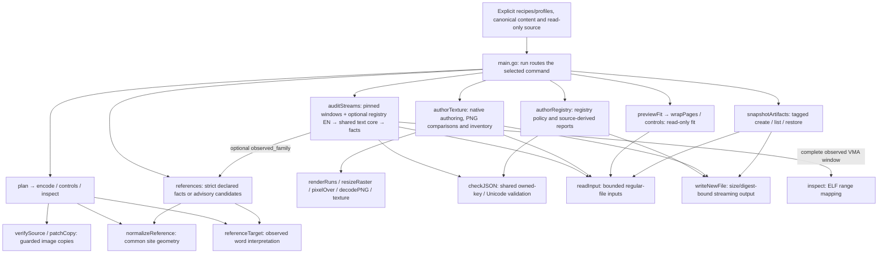
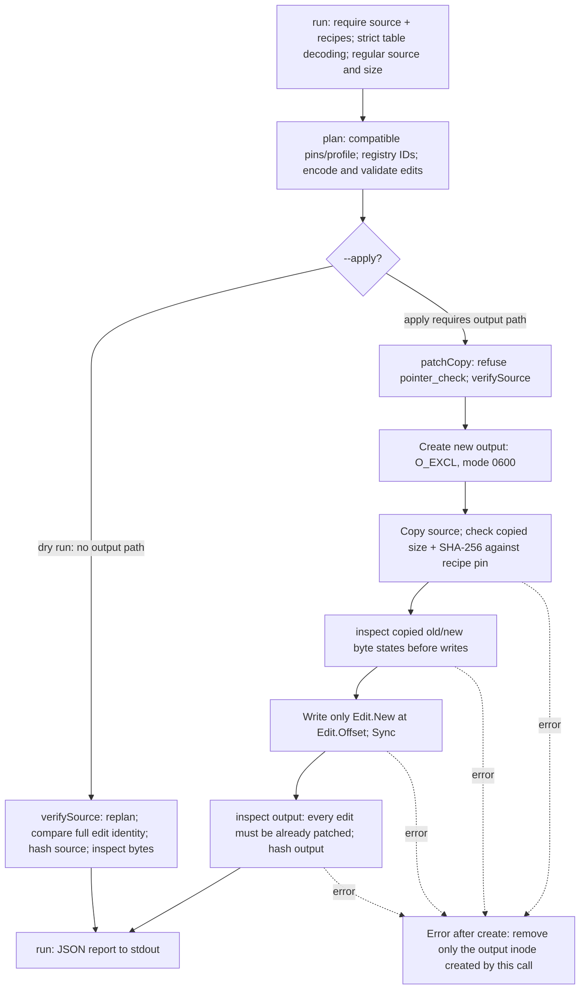
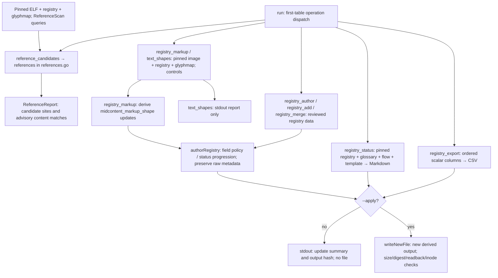

# Go runner architecture

[Open the standalone visual diagram](ARCHITECTURE.html) (offline HTML with embedded SVG).

This is one `package main` CLI with scoped operations in all14 core areas.
That is availability, not complete historical coverage: six of14 family
contracts are fully verified. The [historical ledger](evidence/go-coverage.json)
records8 full Go paths,20 reviewed historical dispositions,16 partial paths and
366 outstanding out of410. See [the14-area owner map](analysis/reusability-coverage.md)
for current extension points and explicit limits. The
[integrated checkpoint](evidence/registry-owner-proof.json) passes the full Go
race suite, build, vet and scoped checks; it is not a gameplay or new ISO proof.

## Components and contracts

Arrows below mean calls or explicitly labelled data flow. Boxes group existing
responsibilities, not separate executables or proposed packages.

`--registry`, `--glyphmap` and `--source` supply explicit paths. The runner does
not hardcode those locations. [registry_types.go](registry_types.go) projects
image-patch inputs; [image_types.go](image_types.go) holds `Edit` and `Inspection`;
[text_types.go](text_types.go) holds scanner/encoder contracts. All are shared Go
types, not new layers.

Evidence: [run](main.go), [plan](patch.go),
[encode](patch.go), [controls](patch.go),
[wrapPages](wrap.go), [validateEdits](patch.go),
[inspect](patch.go), [recipe contracts](recipe_types.go).
Example image operations include `same_length_stream`, `exact_control_stream`, `fixed_field`, `pointer_check`,
`stream_append`, `stream_grow`, `stream_allocate` and `guarded_words`.
It uses `inspect` for applicable native profiles, not every simple field patch.

## Image dry run and apply

Recipe loading accepts one file or only the immediate `*.json` files of a selected
directory, in filename order; it does not recursively load `recipes/**/*.json`.
`plan` checks the glyphmap pin and table compatibility. `verifySource` checks the
complete source hash and compares the supplied edits with a fresh plan, including
ID, offset, operation and old/new bytes. `inspect` refuses unexpected bytes and
recognizes old versus already-patched states. `pointer_check` is verification-only
for declared data/struct pointers and strict LUI/ADDIU pairs. Its opt-in
`registry_landing` state checks canonical landing VMAs; the default checks original
IDs. Code guards reuse same-byte `guarded_words` edits, while the table still
forbids writes. Neither word equality nor site membership proves text content or
reference completeness. `stream_append` can also opt into
those landings, with a scope hash pinning ID, destination and listed sites. This
keeps allocation logic shared while permitting the historical stream order to
differ from numeric registry-ID order. The planner derives exact allowed pointer
ranges from those same pinned sites, so each table does not repeat them.

`patchCopy` never writes the source. Exclusive creation refuses existing outputs,
including existing aliases, and error cleanup checks inode identity. The successful
result contains the output SHA-256. Independent whole-image containment checks and
two fresh reviews for real-image application remain an external project requirement,
not extra stages secretly performed by `patchCopy`; see [AGENTS.md](AGENTS.md).

Evidence: [recipe loading and mode guards](main.go),
[image dispatch/report](main.go), [verifySource](patch.go),
[patchCopy](patch.go). Compatible append tables share the existing allocator;
filename order then numeric registry-ID order determines allocation. Different
source pins mean separate transactions, not an implicit staged pipeline.

## Registry operations and read-only reports

These branches require one reviewed table. Reference reports and `text_shapes`
refuse apply; candidate reports never authorize patching or mutate the registry.
`elf_layout` shares the bounded source-read, recheck and JSON publication path
with reference reports. It delegates PT_LOAD validation and named range mapping
to `inspect`, using the standard-library ELF parser. Its only inputs are a pinned
standalone executable and named address ranges; BSS and unmapped pieces carry no
file range. Fixed-delta patch planning and ISO directory mapping remain separate.
Reference discovery has its own advisory glyph projection, rather than using the
patch scanner to prove runtime safety. Its high-half heuristic does not establish
register liveness, reachability or exhaustive references.

Registry document operations live in [authorRegistry](registry_authoring.go),
separate from routing and image `patchCopy` calls.
CSV projection reuses its raw source/ID/Unicode validation and final publisher;
the recipe owns column order. Exact CSV quoting preserves embedded CR/LF,
unlike Go's CSV CRLF mode. CSV export does not update registry dates or derive
disc-truth content.
`registry_author`, `registry_add` and `registry_merge` read the registry through
`--source`; derived markup and shape
analysis additionally use the image and explicitly pinned registry/glyphmap.
Machine-owned field allowlists protect canonical English; registry apply creates a
new file and never updates the canonical registry in place.

Evidence: [command dispatch](main.go),
[registry policy and source-derived reports](registry_authoring.go),
[shared exclusive publisher](outputs.go), [references](references.go),
[report types](reference_types.go). Example tables:
[registry markup](recipes/registry/markup.json),
[text shapes](recipes/reports/text-shapes.json),
[reference queries](recipes/reports/references/help-misc-labels.json).

## Declared reference observations

`reference_observed` enhances [references](references.go) with a separate strict
family-selection branch. Existing candidate scanning keeps its advisory grammar
and output. [normalizeReference](reference_geometry.go) extracts shared data,
struct and code geometry used immediately by expected pointer guards, append and
the report. `referenceTarget` extracts append's observed word interpretation for
append and the report; expected word construction remains with the planner.
Neither helper maps sources, chooses targets, checks consumer ownership or
publishes writes. [reference_types.go](reference_types.go) groups numeric geometry
and per-site observations with the existing canonical site contracts.

Existing `inspect` supplies complete-word and target-point ELF mappings. Reports
retain missing words, errors, repeated-site ordinals and divergent targets; an
unmapped scalar is not replaced with an ID. `run` shares the bounded source/read/
hash/report lifecycle and rechecks registry, recipe and source-path identities.

`reference_gp_index` uses the same `references` owner for a source-window index
without registry or glyph inputs. `inspect` still owns ELF validity, GP metadata
and forward mapping. The index proves unique reverse file-to-VMA coverage before
classifying supported GP-base forms; target points use the existing mapper in
bounded batches. The strict `referenceTarget` contract remains for declared
address-construction sites: memory effective addresses and discarded values do
not satisfy that contract. `run` shares profile/source checks and bounds the
complete output. The two index fact types live with other reference contracts.
No per-script handler, decoder framework or new function is introduced.
See the [family selector](recipes/reports/observed-references.json) and
[proof](evidence/observed-reference-proof.json). Strict registry Unicode validity
is an input policy, independent of preserving unknown metadata in source files.

## Paired stream audit

`run --stream-audit-profile` is an exclusive read-only branch, separate from
patch recipes and authoring. [auditStreams](stream_audit.go) owns the paired
input/hash/recheck/report lifecycle; existing `controls` owns decoding. It reads
explicit bounded file windows from two pinned regular sources, with no VMA,
reference or grammar inference. Whole-source streaming hashes precede output.
One error side makes semantic comparisons unknown; complete-window byte facts
remain available. Through-END equality and selected-window tails are separate.

[stream_audit_types.go](stream_audit_types.go) groups its contracts.
[input_types.go](input_types.go) now holds the existing input pin and JSON-policy
types shared by registry and audit callers. [checkJSON](inputs.go) is the existing
registry scanner extracted once: selective opaque metadata policy is preserved,
while the audit profile/glyphmap owns every object. No second decoder, encoder,
writer or address mapper was introduced. See the [example](examples/stream-audit/profile.json)
and [reuse decision](analysis/stream-audit-reuse-decision.json).

Optional `observed_family` adds a pinned registry to the same source-record slice
and final hash/identity checks. The existing audit calls `references` for actual
declared-site facts and `inspect` for the full explicit observed window. Exact
numeric ID sets, every valid site, one common target and one matching file-backed
range are required before publishing. Reference windows and grammar remain
explicit. This adds no function, decoder, mapper or CLI path. Its
[example](examples/reference-bound-audit/profile.json),
[reuse decision](analysis/reference-bound-audit-reuse-decision.json) and
[proof](evidence/reference-bound-audit-proof.json) distinguish stored references
from runtime reachability and complete canonical-plan reconciliation.

An entry's optional canonical policy reuses the same audit lifecycle. Registry EN
and the original window feed existing `controls` readiness and `encode` with
explicit no-wrap or character budgets; the generated stream becomes a third
side of the existing scanner and comparison loop. `references` and `inspect`
still gate publication. Failed generation preserves independent observations
and omits canonical comparison. Generated spans are buffer offsets. This adds
no function, file, decoder, writer or planner bypass. See the
[canonical example](examples/canonical-audit/profile.json) and
[reuse decision](analysis/canonical-audit-reuse-decision.json).

## Where to extend

Keep patch-specific values and evidence in purpose-grouped recipe JSON keyed by
stable registry IDs, and keep English in the canonical registry. First check
whether the existing operation accepts the new table. Extend `plan`, `encode`,
`controls`, `inspect`, `validateEdits`, `wrapPages`, or `authorRegistry`
when their shared behavior needs a change; use the14-area map for fit, raster,
texture, snapshot and report owners. Do not add a handler
per historical Python script. Update the existing cases in
[patch_test.go](patch_test.go) for the affected contract and refusals. Character
wrapping budgets do not establish physical text fit, and a byte proof does not
establish gameplay or full migration.

## Authoring and artifact operations

`previewFit` reads separate consumer profiles; it does not authorize a write.
`authorTexture` shares calibrated codecs with PNG exports and cell/run/group
rendering. `composeCells` owns fit groups, approved ink bounds, separate background
paint and ordered composition; `renderRuns` owns native glyph/style and fixed-size
inline-icon slot geometry. `composeCells` copies immutable original RGBA icons
after each line, with full source/destination containment,
and `resizeRaster` is the shared numerical resampler. Existing rendering selects
LANCZOS explicitly; preview NEAREST copies straight channels with source-ordered
binary64 sampling. Optional nearest crop coordinates are relative to source
content, with zero padding outside it and no padded-input allocation. Its larger
16M-pixel output budget is separate from the unchanged 1M-pixel LANCZOS and source
bounds. Pinned TrueType sources reuse the same styled run path. Finite masked
row/column reconstruction now shares the ordered compositor; other donor
algorithms remain open. The shared native font backend is described below. `indexTextures` now supplies raw native headers to a read-only
inventory, authored specification joins and the calibrated codec. Its shared
name-to-ordinal index retains duplicates; exact selection keeps existing error
precedence. Specification and batch decodes pass the already parsed index to
`texture`, bound to the exact immutable source byte view. Different buffers refuse
reuse; standalone decoding and new artifact readback retain fresh parsing. `authorTexture` joins separate stable-ID-keyed annotation tables to
selected native identities and codec-derived geometry/hashes. Unknown decoder
results remain null; declared archive/member labels are not verified placements.
Inventory preserves duplicate names and
per-entry metadata errors; it does not assess storage/pixel support or replace
contact sheets. `manifestTextures` streams extracted CMB batches through the
existing `cmbIndex`, which retains original index order separately from name
lookup. It reuses `indexTextures` and `texture` for each member, preserving all
entry/error rows, and joins authored annotations by exact entry/native identity.
`inspectRaster` owns unchanged-pixel discovery counters and tier/flag policy;
palette generation cannot own this because it changes alpha and hidden RGB.
Manifest publication uses one deterministic ZIP through `writeNewFile`, after
source/profile rechecks. Pixel budgets retain error rows; global bundle bounds
refuse publication. `decodePNG` is the shared bounded PNG normalization owner;
it preserves the established Pillow conversion and charges attempted pixels even
when payload decoding fails. `authorTexture` also assembles checkerboard pairs
from pinned PNGs through `resizeRaster` and `pixelOver`, then rechecks all input
bytes before the existing exclusive publisher. The same comparison path now reads
checker, flat and weekday facts from `profiles/previews/pair-layouts.json`.
Flat panels crop/pad unequal sources and scale their gap; weekday captions use
`textMasks` before whole-page nearest scaling. A narrow `rgbaPNG.Opaque` method
preserves the flat PNG alpha channel through the standard encoder. Other encoder
callers keep their existing formats. The [final contact proof](evidence/asset-contact-score-policy-proof.json) closes
the original source-family contract. Explicit detector status preserves unknown
measurements while retaining eligible pages; absent records stay separate.

The contacts dispatch consumes pinned manifest ZIPs through `contactSheets`.
It collects rows across inputs, removes duplicates within each non-UI group before
sorting, renders pages and resolves final inventory links. Shared preview members
are measured once; thumbnails are cached on first use. Physical caption lines
retain their original colours and spacing. Each thumbnail is painted immediately
before its labels, preserving overlap with later items. It reuses `readInput`,
`checkJSON`, `resizeRaster`, `pixelOver` and `writeNewFile`. Layout facts live in
`profiles/previews/inventory-layout.json` rather than patch-recipe schemas.

`RasterComposition` groups cells, icons, reconstruction facts and explicit step
order; `RasterRender` adds optional pinned font resources. `composeCells` owns
one working clone, allow/exclude/add geometry, step order, and per-step text byte
containment. `reconstructRaster` owns selection, four-neighbor growth and local
straight-RGBA interpolation. That numerical responsibility cannot reasonably live
in font measurement, native encoding or the already broad cell compositor; the
[reuse decision](analysis/reconstruction-row-reuse-decision.json) records the
alternatives. Donor-only compositions load no font. Mixed compositions read the
current canvas for text and donors, but retain immutable original icon crops.
Native rectangles remain coarse; exact permission containment is checked before
import and independently after native readback. `RasterSelection` now groups the
existing flat fields with RGB exclusions and saturation. `RasterErase.All` holds
at most32 extra AND clauses, with per-clause tolerances; the same kernel validates
and evaluates them, with selection work charged before composition. No new
function, source file, callback or recursive boolean engine is needed. One new function and two new
source files are capability growth, with no historical retirement or savings.

`textMasks` is the independent TrueType layout/hinting boundary, returning owned
Gray masks, bearings, unrounded advances, ascender/descender metrics and signed
fractional starts. It reuses a FreeType face and Raqm shaper per batch.
`RasterFont` selects an atlas or a pinned TrueType source. `renderRuns` shares
fitting/styling and preserves original implicit LF painting before styling;
explicit groups retain their later per-line composition. Bitmap optical rendering
keeps its existing contract.
The `nativefonts` Linux/CGO build links installed libraries; the complementary
build supplies the same function's explicit refusal, preserving the other tools
without native dependencies. Both declarations, headers, font assets and notices
are counted. This is capability growth, with no source-retirement credit.

`snapshotArtifacts` uses explicit files and per-tag receipts, without registry or
patch prerequisites. Restore verifies a digest and creates a new output. Listing
does not hash payloads. `readInput` owns bounded reads; `writeNewFile` owns
streaming size/digest/readback and exclusive publication for snapshots, registry
and texture outputs. Image transactions retain `patchCopy` and its replan guards.

Reference/content matching is advisory selected-scope reconciliation, not a
complete plan-versus-disc audit or hook-safety proof. Keep these narrow operation
labels when describing the14-area baseline. Registry extraction moved482 existing
lines unchanged and added568B of boundary overhead; splitting alone is not reuse
or code reduction. Shared structs remain grouped by usage, including
[RegistryOptions](registry_types.go), [snapshot contracts](snapshot_types.go) and
[font/run/group contracts](raster_types.go).

`previewFit` also owns optional exact LINE-count constraints in `FitBox`.
It counts existing `controls` page-row vectors, including trailing breaks, and
retains all overflow diagnostics before reporting `row_count_mismatch`.
Constrained boxes refuse wrapping; unsupported measurements leave the count
unknown. No second scanner, formatter or patch-specific handler is involved.

Source-state prefix preservation stays inside existing `encode`. For decoded
source context only, a payload-free setup/non-scale pen prefix is copied in order
and independently scanned by `controls`; translated content shares existing
wrapping and complete validation. The prefix is outside the character budget.
No new function/type/mode or global grammar relaxation is needed. Colour/opaque
policies and complete native append/write validation remain separate; read-only
canonical generation can advance while unproven write/reader forms still refuse.

The optional canonical authoring choice belongs to the existing audit policy and
encoder options: `markers` (default) or `plain`. It is semantic input because the
same original source/wording can succeed through plain and refuse through mixed.
Existing encode owns order, speaker replacement, prefix validation and strict
body validation; controls keeps source/readiness facts. No new function, parser,
writer or dispatch layer is introduced. Source prefix colour persists across
pages and is excluded from authored-body pairing and wrapping budgets.

Fixed16 fields follow the same audit lifecycle with a bounded glyph grammar.
Existing encode owns literal nonterminated text; controls decodes an exact word
count without END. Existing reference observation normalizes/reads declared
inline coordinates without referenceTarget, then inspect maps full original and
installed fields. The shared third-side comparator retains unknowns and complete
raw hashes. ReferenceMappings is optional; old narrative reports remain byte-
identical. No additional parser, executor, function or per-name handler exists.

`inspect` owns sentinel allocation facts alongside ordinary ELF ranges. It first
maps twelve installed protocol words with a bounded PT_LOAD-only call, then
adds a distinct loaded `sentinel_blob` interval to the same interval projector.
The larger dispatch interval remains a reported recognition fact. No synthetic
program header or pointer-target fallback is introduced. `references` continues
to observe declared stored targets; `auditStreams` checks the complete selected
window against the separately proved loaded mapping before publishing comparisons.
`SentinelLayout` groups source coordinates; `SentinelAllocation` groups observed
window, loaded interval and instruction evidence. Existing disc-write Stream
profiles retain their separate directory/growth/consumer contracts.

`controls` owns pinned raw role interpretation. `TextReadPin` groups source hash,
word count, explicit relative END offset and existing `TextToken` roles. Local
one-word surrogates reuse the established decoder; exact offsets and role values
are restored before any context summaries, with blocked authoring readiness.
`auditStreams` passes independent side pins and keeps physical reference/window
binding separate. `checkJSON` extends its existing key tracking with scoped
required keys so missing zero-valued role facts cannot silently become defaults.
No per-pool handler, second decoder or duplicate raw-control report field is added.

GP-relative observations follow the same reference path: ELF inspection supplies
optional register-info provenance, normalized single-ADDIU sites supply actual
words, and the shared target interpreter combines them. Unknown metadata retains
readable site words with errors. Geometry never supplies a declared GP base;
read facts grant no writer authority. `ELFRegisterInfo` groups this shared fact.

Reviewed reconciliation stays in `auditStreams`, which already owns pinned
source lifecycles, canonical encoding, observed references and whole-window
mapping. Optional per-entry review facts select advisory machine-field proposals
without another pipeline or flag. `StreamAuditReview` holds editorial scope;
`StreamAuditReconciliation` holds computed decisions, never supplied proof flags.
`authorRegistry` remains the separate downstream field-policy publisher.
Missing review or unknown evidence holds a row. Human wording and attribution
remain untouched; matching bytes cannot clear an explicit hold. Existing callers
and unreviewed profiles retain their prior output. No new functions were added.

Inline16 reuses the same reviewed decision path. Existing field geometry and
both complete16byte mappings establish its location before any proposal; no
pointer interpretation, decoder, handler, helper or additional type is introduced.
The fixed example owns review/status facts, preserving its prior28byte/token
cases and all original glyph/control validation. Human fields and attribution
remain outside generated proposals.

Optional audit `line_limit` facts stay in auditStreams beside the decoded sides.
They report source-defined token/page structure and reference-relative line growth;
previewFit retains authored font-advance budgeting. Neither substitutes for the
other. Existing audit/fit/export/status reports compose through their source pins
and explicit selected-ID coverage. A separate join engine is unnecessary for this
workflow; the README documents the four existing commands.

The finite instruction index shares the reference reporter's validated reverse
LOAD partition and source-word walk. [Instruction forms](instruction_forms.go)
are one authoritative address-form table consumed by both GP classification and
operand reporting. [Instruction types](instruction_types.go) group raw words,
operand roles and local control alternatives. GP point mapping and instruction
delay resolution remain separate terminal paths. Optional register requests go to
[queryRegisterFlow](register_flow.go), a pure analysis boundary consuming the
already decoded rows. It builds one bounded context graph per batch and shares
one worklist loop between before-read definitions and after-execution uses.
[Register-flow types](register_flow_types.go) keep entry assumptions, requests and
conditional results together. The scanner retains source/mapping/report ownership;
no ELF reread, second instruction decoder, call-return framework or patch handler
is added. Normal entry provenance is independent of predecessor count, and delay
states retain the controller and outcome rather than guessing from physical PC.

The finite byte producer is now [indexInstructions](instruction_index.go), shared
by existing GP/instruction index routes and the optional registry caller report.
It owns reverse LOAD partitioning, the word walk, finite operands and local paths,
not registry policy or graph traversal. [references](references.go) retains input
validation and registry/report association; [queryRegisterFlow](register_flow.go)
retains one pure graph per batch. The existing site-owner collection also projects
lower-reader ownership without changing exact-pair or memory collision keys.
[Caller types](reference_flow_types.go) keep stable-ID recipe tuples separate from
computed row diagnostics. The extraction moves one implementation, not deletion.

[selectRaster](raster_mask.go) now owns bounded pixel-mask construction for current
erases and original permissions. It compiles finite scalar checks and composes
OR groups with the source's fixed footprint phases. [transformRasterMask](raster_mask.go)
shares four-connected binary topology with reconstruction growth and font counters;
its returned mask never aliases input. Callers retain image choice, global geometry,
ordering and publication. [Mask types](raster_mask_types.go) keep authored facts and
compiled comparisons separate. The existing compositor retains one allow/subtract/add
loop for both rectangles and masks; the existing authoring loader owns pinned tables
and closed JSON validation. Source facts live in separate asset-keyed tables.

Component size, foreground seed membership and tag veto share the existing
transformRasterMask component walk. Four/eight connectivity belongs only to that
walk; morphology and font counters retain four neighbors. RasterComponentFilter
keeps the related facts together. selectRaster evaluates its main/core/tag roles
through one predicate loop, with optional SampleRect limiting input selection
while Rect retains topology/output bounds. The existing authoring validator checks
component tag selectors as a separate raw subtree because their object depth
coincides with main scalar maps. No new function or per-provider implementation is
needed. Background label-zero selection and post-selection erosion now reuse those same
owners. Label zero reads immutable component input and covers the complete topology
Rect, so source flood recipes keep that domain equal to their original crop.
Advanced reconstruction and source-art contracts remain open.

## Ordered source text codec - 2026-11-05

[Contract](analysis/ordered-text-contract.json), [proof](evidence/ordered-text-proof.json) and [review](evidence/ordered-text-review.json) bind the original finite text-codec requirements. Existing encode/controls/wrapPages share the lexer, layout and byte writer; no chapter-specific handler or new function. One local occurrence record carries token, placeholder ID, prefix/pair role and speaker boundary. Payload bytes never enter word-level layout/highlight scans. Fit, plan and canonical audit expose the same explicit source policy while preserving unknown native/write refusals.

111 source-policy cases, changed/noop literal bytes, context and resource refusals, exact whole-copy containment, core/native focused tests, build/vet/format/hygiene and post-guard CLI race pass. Independent review closed a duplicate-prefix-speaker override defect and Astra045 parallel bookkeeping finding. Full9/14, planning73/84, text6/6;410 script retirements unchanged. Unknown native fit, opaque writes, narrative E000 ABI and multi-rune authoring remain explicitly unproved. Full suite/nativefonts race/gameplay remain deferred.
